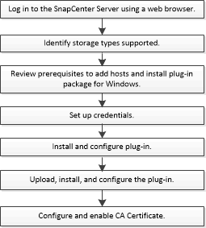

= SnapCenter Plug-in per Microsoft Exchange Server flusso di lavoro di installazione
:allow-uri-read: 
:icons: font
:imagesdir: ../media/

[role="lead"]
Se si desidera proteggere i database di SnapCenter, è necessario installare e configurare il plug-in di Exchange.

