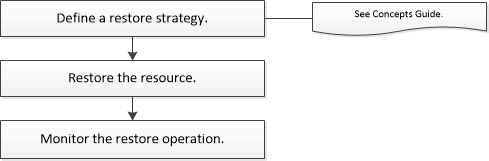

= Flusso di lavoro di ripristino del database Oracle in SnapCenter
:allow-uri-read: 
:icons: font
:imagesdir: ../media/

[role="lead"]
Il flusso di lavoro di ripristino include la pianificazione, l'esecuzione delle operazioni di ripristino e il monitoraggio delle operazioni.

Il seguente flusso di lavoro mostra la sequenza in cui è necessario eseguire l'operazione di ripristino:

