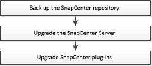

= SnapCenter flusso di lavoro di aggiornamento del server
:allow-uri-read: 
:icons: font
:imagesdir: ../media/

[role="lead"]
Ogni release di SnapCenter contiene un pacchetto di plug-in e server SnapCenter aggiornati. Gli aggiornamenti dei pacchetti plug-in vengono distribuiti con il programma di installazione di SnapCenter. È possibile configurare SnapCenter per verificare la disponibilità di aggiornamenti.

Il flusso di lavoro elenca le attività che è necessario completare per aggiornare i pacchetti SnapCenter Server e Plug-in.

[[recommended-upgrade-path]]
== Percorso di upgrade consigliato

NetApp consiglia di aggiornare alla versione più recente supportata di SnapCenter, la 6.2.3, per garantire compatibilità e prestazioni ottimali con SnapCenter.

CAUTION: Per eseguire l'aggiornamento a SnapCenter 6.2.3 da una versione precedente alla 6.0 o dalla 6.0, aggiorna prima alla 6.1P3, che supporta .NET 8 e Java 11, e poi alla 6.2.3, che supporta .NET 10 e Java 17. Non utilizzare la 6.2.2 o qualsiasi altra versione intermedia come parte del percorso di upgrade, a meno che tu non la stia già utilizzando.

Per ulteriori dettagli sull'aggiornamento dei tuoi host, fai riferimento a *Upgrade Hosts to SnapCenter 6.2.3* nel link:https://library.netapp.com/ecm/ecm_download_file/ECMLP3359467["SnapCenter Note di rilascio"^].

[[supported-upgrade-paths]]
=== Percorsi di upgrade supportati

Questa sezione mostra da quali versioni SnapCenter è possibile effettuare l'aggiornamento e quali versioni dei plug-in sono supportate.

NOTE: Se si aggiorna SnapCenter Server alla versione 6.2, aggiornare anche i plug-in alla versione 6.2.

|===
| Se si utilizza la versione del server SnapCenter... | È possibile aggiornare direttamente il server SnapCenter a... | Versioni plug-in supportate 

.4+| 6.0.1 | 6,1  a| 
* 6.0.1
* 6,1

| 6,2  a| 
* 6,2

| 6.2.1  a| 
* 6.2.1

| 6.2.2  a| 
* 6.2.2

.4+| 6,1  a| 
6,2
 a| 
* 6,1
* 6,2

| 6.2.1  a| 
* 6.2.1

| 6.2.2  a| 
* 6.2.2

| 6.2.3  a| 
* 6.2.2
* 6.2.3

.3+| 6,2 | 6.2.1  a| 
* 6,2

| 6.2.2  a| 
* 6,2

| 6.2.3  a| 
* 6.2.2
* 6.2.3

|===
Fai riferimento a *Aggiorna gli host a SnapCenter 6.2.3* nel link:https://library.netapp.com/ecm/ecm_download_file/ECMLP3359467["SnapCenter Note di rilascio"^] per ulteriori dettagli sull'upgrade dei tuoi host a SnapCenter 6.2.3.

Per informazioni su come aggiornare il SnapCenter Plug-in for VMware vSphere, vedere https://docs.netapp.com/us-en/sc-plugin-vmware-vsphere/scpivs44_upgrade.html["Upgrade del plug-in SnapCenter per VMware vSphere"^] .
